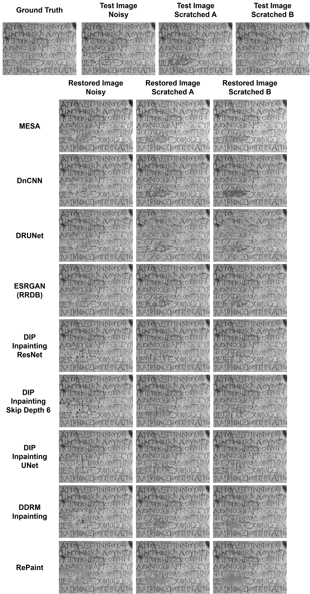
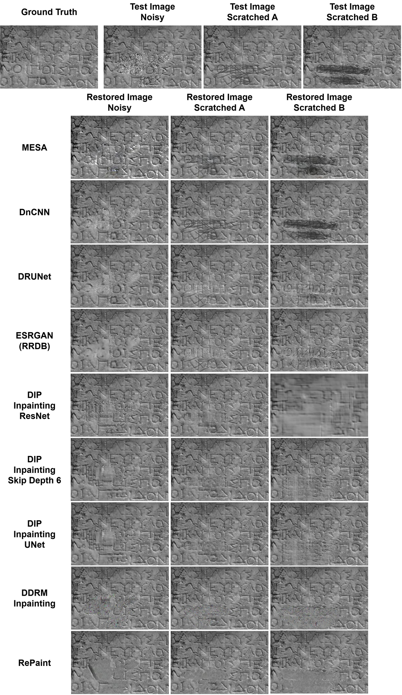
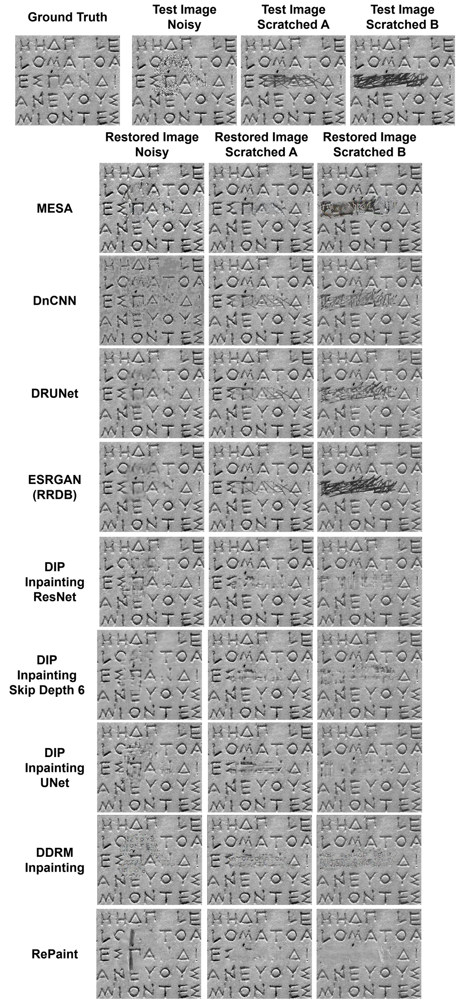
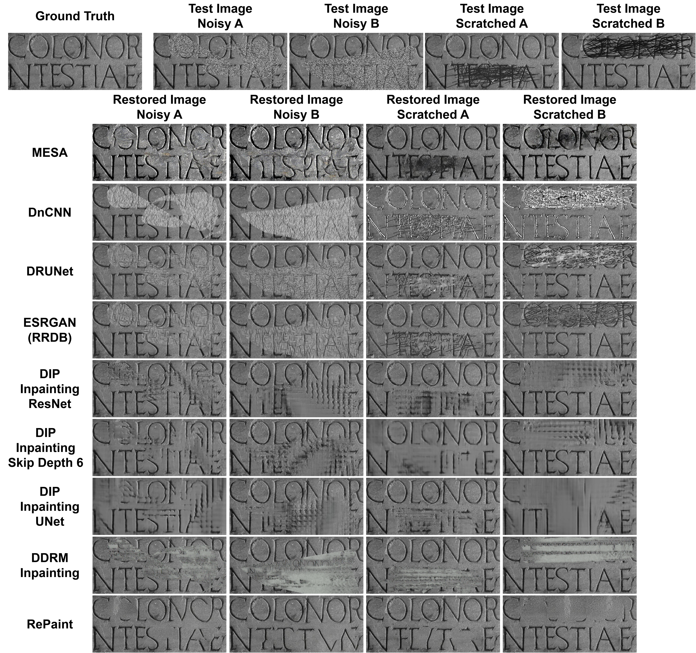
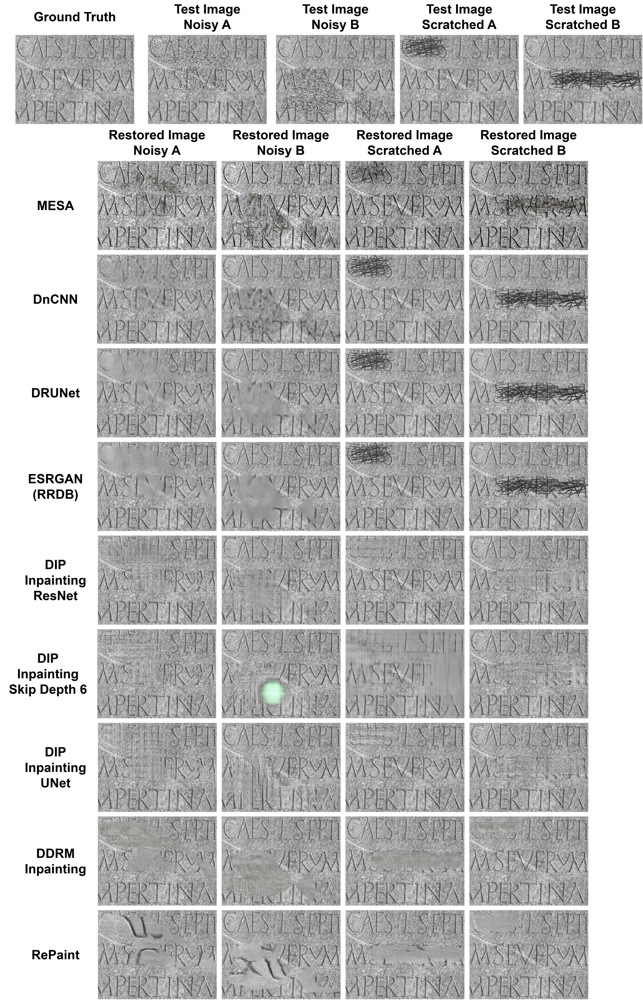

# Epigraphic Image Restoration Methods: A Comprehensive Comparison from Multi-Exemplars and CNNs to GANs and Diffusion

This repository accompanies the paper *Epigraphic Image Restoration Methods: A Comprehensive Comparison from Multi-Exemplars and CNNs to GANs and Diffusion*. It contains the implementation of the proposed **Multi-Exemplar Style-Aware (MESA)** framework, the datasets, and the full-resolution result figures of the paper.

Ancient inscriptions often exhibit missing, eroded, or degraded regions caused by weathering, fragmentation, and human-induced material deterioration. The paper presents a comparative evaluation of deep-learning-based restoration approaches for inscription imagery:

- **MESA** (proposed): uses well-preserved exemplar inscription segments to guide the reconstruction, without task-specific supervised training or paired damaged–clean data
- **CNNs:** DnCNN, DRUNet
- **GANs:** ESRGAN (RRDB)
- **Deep Image Prior (DIP):** Inpainting with ResNet, Skip (depth 6) and UNet architectures
- **Diffusion:** DDRM and RePaint, with a memory-efficient tiled inference strategy that substantially reduces their GPU memory requirements

The methods are evaluated with image-quality metrics (SSIM, PSNR, LPIPS-AlexNet), OCR-based text similarity (Levenshtein distance, Log-Levenshtein Similarity, TRS), participant ratings, and computational cost.

## Datasets

Five datasets are used, three of Ancient Greek and two of Latin inscriptions. The clean images of each dataset are used as exemplars by MESA and as ground truth for the paired damaged–clean training data of the supervised methods. Separate models are trained for noise and for scratches, each one with its own set of pairs. All methods are evaluated on the same damaged test images of one inscription per dataset.

| Dataset | Script | Exemplars (clean) | Training pairs (noise) | Training pairs (scratches) | Test images (noisy + scratched) |
|---|---|---|---|---|---|
| A | Ancient Greek | 19 | 19 | 19 | 3 (1 + 2) |
| B | Ancient Greek | 19 | 19 | 19 | 3 (1 + 2) |
| C | Ancient Greek | 19 | 19 | 19 | 3 (1 + 2) |
| D | Latin | 20 | 20 | 20 | 4 (2 + 2) |
| E | Latin | 39 | 39 | 39 | 4 (2 + 2) |

## Downloads

**Datasets** (exemplars for MESA and ground truth for the methods that require supervised learning):

https://drive.google.com/file/d/1cdpitRfraO1QmyQnqSRVv_I3tkeU9fv_/view?usp=sharing

**Training pairs** (damaged–clean pairs used to train DnCNN, DRUNet, ESRGAN, and the diffusion model used by RePaint and DDRM):

PAIRS_LINK

Password: PAIRS_PASSWORD

## Dataset Insights

### Dataset A

*Dataset A (Ancient Greek) used as exemplars in MESA or as ground truth in techniques that require supervised learning.*

---

### Dataset B

*Dataset B (Ancient Greek) used as exemplars in MESA or as ground truth in techniques that require supervised learning.*

---

### Dataset C

*Dataset C (Ancient Greek) used as exemplars in MESA or as ground truth in techniques that require supervised learning.*

---

### Dataset D

*Dataset D (Latin) used as exemplars in MESA or as ground truth in techniques that require supervised learning.*

---

### Dataset E

*Dataset E (Latin) used as exemplars in MESA or as ground truth in techniques that require supervised learning.*

## Results

Full-resolution versions of the result figures of the paper. Each figure shows the ground truth and the damaged test images (top row), and the restored images of all methods (one row per method: MESA, DnCNN, DRUNet, ESRGAN (RRDB), DIP Inpainting ResNet, DIP Inpainting Skip Depth 6, DIP Inpainting UNet, DDRM Inpainting, and RePaint). Click on an image to open it at full resolution and zoom into any region.

### Dataset A

*Comparison of the outputs of MESA per test image, using Ancient Greek Dataset A images as exemplars, with other well-known methods.*

---

### Dataset B

*Comparison of the outputs of MESA per test image, using Ancient Greek Dataset B images as exemplars, with other well-known methods.*

---

### Dataset C

*Comparison of the outputs of MESA per test image, using Ancient Greek Dataset C images as exemplars, with other well-known methods.*

---

### Dataset D

*Comparison of the outputs of MESA per test image, using Latin Dataset D images as exemplars, with other well-known methods.*

---

### Dataset E

*Comparison of the outputs of MESA per test image, using Latin Dataset E images as exemplars, with other well-known methods.*
